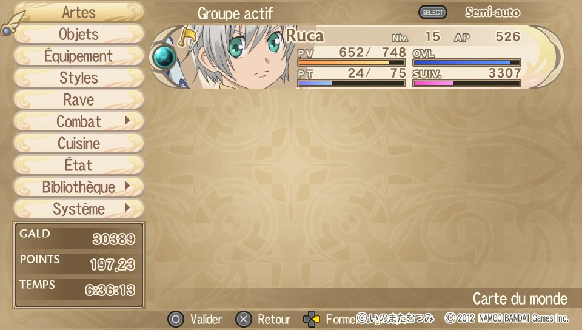

# Tales of Innocence R

Patch de traduction française pour *Tales of Innocence R*.

## Télécharger et installer

**[Récupérer la dernière version](https://github.com/lolerki/tales-of-innocence-R-fr/releases)**

Sur la page des versions, téléchargez l’archive Windows la plus récente. Décompressez-la et ouvrez `LISEZ-MOI.txt`. L’outil de patch est inclus.

Il vous faut votre copie japonaise du jeu (**PCSG00009**), un PC sous Windows 64 bits et une PS Vita équipée de rePatch. La notice indique quels fichiers préparer et où installer le patch.

## Aperçu

| Écran titre | Menu en jeu |
| --- | --- |
|  |  |

Les autres personnages ont été masqués pour éviter les spoilers.

## Contenu du patch

Le jeu est entièrement traduit. Je poursuis la relecture, en priorité sur l’histoire principale. Quelques repères d’interface, comme `ALL` et `ON/OFF`, gardent leur lettrage d’origine.

## À propos du projet

J’ai commencé ce projet en 2025, seul et sans IA. J’ai extrait les fichiers du jeu et commencé à traduire les premières scènes. Au fil du travail, je me suis rendu compte qu’à mon rythme, traduire le jeu entier serait hors de portée.

En 2026, j’ai commencé à utiliser l’IA pour préparer des traductions, explorer plusieurs formulations et m’aider à les relire. Le japonais a servi de référence, et la traduction anglaise de Life Bottle Productions et ses notes m’ont aidé à éclaircir certains passages. Pour les dialogues, j’ai cherché à comprendre qui parle, à qui et avec quelle intention. Une pique taquine d’Illia et une hésitation de Ruca n’appellent pas le même français. J’ai revu les formulations en contexte et testé le patch sur ma PS Vita.

## Signaler un problème

Vous pouvez ouvrir un signalement et choisir **Traduction ou texte** ou **Affichage ou installation**. Indiquez la version du patch et le menu ou la scène concernés. Une capture d’écran peut aider. Si votre retour révèle un élément de l’intrigue, signalez le spoiler et masquez le détail dans un bloc repliable. [Ouvrir un signalement](../../issues/new/choose)

## Remerciements

Merci à **Life Bottle Productions** pour leur traduction anglaise, leurs notes et leurs outils, qui m’ont permis de démarrer ce projet. [Projet Life Bottle](https://github.com/lifebottle/Tales-of-Innocence-R)
