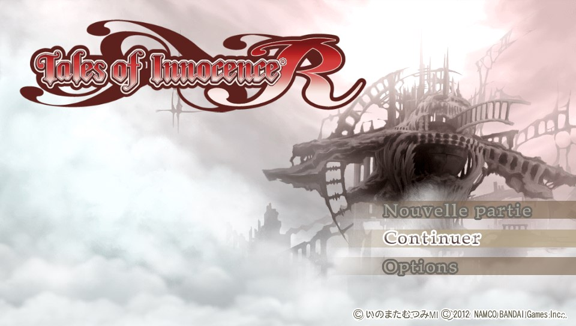

# Tales of Innocence R

Patch de traduction française pour *Tales of Innocence R*.

## Version 1.0

L’histoire est jouable en français jusqu’à la fin. J’ai consacré de nombreuses heures à relire et à corriger les dialogues et les scénettes, à retravailler les formulations et le rythme des échanges, en veillant à préserver les nuances du texte et la façon de parler de chaque personnage.

Quelques repères d’interface, comme `ALL` et `ON/OFF`, gardent leur lettrage d’origine.

## Tests et retours

Le patch a été testé sur PS Vita, mais je n’ai pas encore parcouru l’intégralité du jeu avec la traduction française. Vous pouvez partager vos retours dans les [issues du projet](https://github.com/lolerki/tales-of-innocence-R-fr/issues/new/choose), en précisant la scène concernée et, si possible, avec une capture d’écran.

## Télécharger

**[Récupérer la dernière version](https://github.com/lolerki/tales-of-innocence-R-fr/releases)**

Le choix de l’archive, les prérequis et les consignes d’installation sont indiqués sur la page de chaque version et dans le `LISEZ-MOI.txt` inclus dans le ZIP.

## Aperçu

| Écran titre | Menu en jeu |
| --- | --- |
|  |  |

Les autres personnages ont été masqués pour éviter les spoilers.

## À propos du projet

J’ai commencé ce projet en 2025, seul et sans IA. J’ai extrait les fichiers du jeu et commencé à traduire les premières scènes. Au fil du travail, je me suis rendu compte qu’à mon rythme, traduire le jeu entier serait hors de portée.

En 2026, j’ai commencé à utiliser l’IA pour m’aider à interpréter le japonais, à préparer les premiers jets et à explorer différentes formulations. Le japonais a servi de référence pour le sens, avec l’appui de la traduction anglaise de Life Bottle Productions et de ses notes pour éclaircir le contexte. J’ai repris les propositions scène par scène, en tenant compte des interlocuteurs et de leurs intentions, avant de choisir les formulations françaises. J’ai également testé le patch sur ma PS Vita.

## Signaler un problème

Vous pouvez ouvrir un signalement et choisir **Traduction ou texte** ou **Affichage ou installation**. Indiquez la version du patch et le menu ou la scène concernés. Une capture d’écran peut aider. Si votre retour révèle un élément de l’intrigue, signalez le spoiler et masquez le détail dans un bloc repliable. [Ouvrir un signalement](../../issues/new/choose)

## Remerciements

Merci à **Life Bottle Productions** pour leur traduction anglaise, leurs notes et leurs outils, qui m’ont permis de démarrer ce projet. [Projet Life Bottle](https://github.com/lifebottle/Tales-of-Innocence-R)
